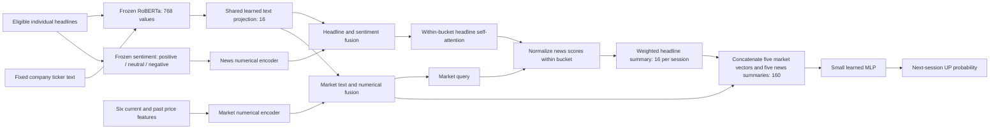

# FININ-inspired public company pipeline

This pipeline preserves FININ's main computation while using the public CMIN-US company-news release. A single compact model is shared across12 companies. This is an independent adaptation; data availability and source-date disagreements limit historical forecasting and publication-age claims.

The shared projection processes company descriptions and headlines independently; the diagram's shared node denotes shared parameters, not mixing their records. Sentiment joins each headline before attention. Attention weights shape the daily summary; they are not additional independent columns in the final MLP. The default final160 values are five16-value market representations followed by five16-value news summaries.

At close d, all five price sessions and news buckets end at d. The target compares adjusted close at the immediately next exchange session q with close at d. A story dated D is provisionally eligible from D+2 midnightUTC and enters its first eligible exchange-close bucket. Weekends and early closes use the exchange calendar. The dataset contains naive source clocks and conflicting dates for some identical URLs; this rule is a conservative assumption, not certified historical availability. Raw source summaries and processed same-row returns are never targets/features.

The completed [19 October timing comparison](../reports/cmin_timing_2026-10-19.md) found no reliable improvement from newer-news policies. Its code and evidence are archived separately; the active pipeline retains the original rule above.

The initial baseline configuration is `configs/cmin_panel_v1.json`: prices with fixed company identity, prices+mean headlines, and the full joint attention pipeline. Exact commands and the frozen temporal/compute protocol are in `docs/cmin_panel_protocol_2026-10-14.md`. Engineering checks establish implementation integrity; forecasting evidence is retained separately in the experiment's saved predictions and summary.

| Professor question | Available control | What it isolates |
|---|---|---|
| Headline relationships | `no_interaction` | Remove headline self-attention while retaining market-query weighting |
| Market-conditioned importance | `no_query` | Retain headline interactions, use uniform within-bucket pooling |
| News-age weighting | `pooled_uniform` vs `pooled_decay`; declared half-life | Same price history and pooled geometry, changing age weighting |
| Age contribution curve | `news_age_sessions` in a separately frozen configuration | Restrict news ages since arrival, preserving all price sessions |
| Sentiment contribution | `no_sentiment` | Remove sentiment information; biased numerical layers remain |
| Semantic headline contribution | `sentiment_only` | Remove headline vectors, retain sentiment and news coverage |
| Final direct market contribution | `no_direct_market` | Remove the market block from the final MLP, retaining prices in its news query |
| All price information | `news_only` | Remove prices from both market query and final predictor |

These controls are implemented and checked, but the default run does not automatically train them. Later studies reuse the audited feature cache in a distinct output folder with their own saved protocol. Pooled temporal models have96 final values, keeping all80 market values plus one16-value pooled news summary; comparison must use matching pooled geometry. Fixed decay on separate concatenated day slots is disallowed because the MLP can absorb it.

Each selected fit stores actual attention, query, fusion, summary and MLP-input tensors for an outcome-independent set of example rows. These traces help explain computation. Predictive contribution requires retrained matched comparisons; attention weights, representation magnitudes and age curves alone do not establish causality or information diffusion.
