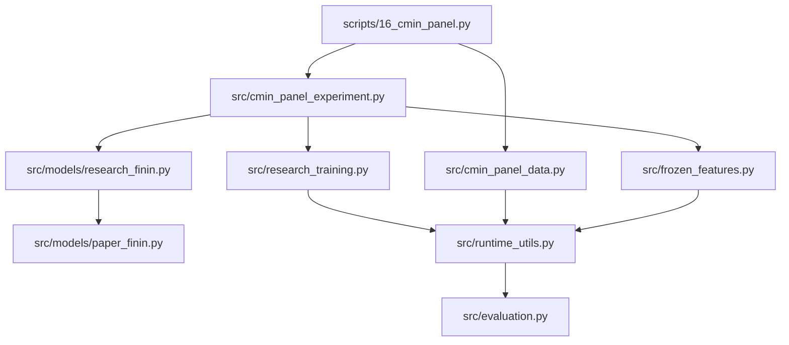

# Code guide: current CMIN pipeline

Start here when reading or changing the code. Retained source modules and commands link back to this file in their module docstrings. Research decisions and results are in [DECISIONS.md](../DECISIONS.md); this guide describes implementation contracts, not evidence that the model forecasts usefully.

The embedding/attention investigation is paused. No LLM scraper/prediction project has been implemented. The 20 October cleanup removed retired NIFTY, StockNet, and SPNews execution code from active folders, extracted shared numerical/cache helpers, and preserved all saved scientific results. [Cleanup audit](../reports/code_cleanup_2026-10-20.json).

## Pipeline entry points

The two `__init__.py` files make `src` and `src.models` packages. The other eight source files below provide the actual current pipeline. Importing them does not automatically train or acquire data. Optional encoder libraries/models load only when encoding is explicitly invoked.

| Command | Responsibility | Execution boundary |
|---|---|---|
| [16_cmin_panel.py](../scripts/16_cmin_panel.py) | Explicit `acquire`, `prepare`, `cache`, `run`, `inspect` stages | Acquisition downloads; caching encodes; run fits only under a declared protocol. Even inspect writes command records. |
| [17_cmin_source_audit.py](../scripts/17_cmin_source_audit.py) | URL/date-source consistency audit | Reads original sources; can write an audit. Requires full local data. |
| [18_cmin_verify.py](../scripts/18_cmin_verify.py) | Verify saved evidence, transforms, and fixed logistic references | Can add audit seals; not the read-only sharing check. |
| [19_cmin_news_consumption.py](../scripts/19_cmin_news_consumption.py) | Fixed-model dependency interventions | Loads local checkpoints and runs inference; no retraining. |
| [20_cmin_decay_preflight.py](../scripts/20_cmin_decay_preflight.py), [21_cmin_decay_analysis.py](../scripts/21_cmin_decay_analysis.py) | Preflight and saved-fit decay analysis | Fixed study paths; preserve completed output directories. |
| [23_cmin_older_news.py](../scripts/23_cmin_older_news.py) | Bounded older-news prepare/run/analyze stages | Run can fit models; exact original identities are checked. |
| [24_report_older_news.py](../scripts/24_report_older_news.py), [25_cmin_subgroup_calendar.py](../scripts/25_cmin_subgroup_calendar.py) | Generate a report and calendar-aware subgroup analysis | Write outputs and refuse conflicting prior evidence. |
| [26_cmin_interaction_analysis.py](../scripts/26_cmin_interaction_analysis.py) | Reconstruct saved attention traces and compare saved fits | Requires local traces/checkpoints; does not train. |
| [audit_repository.py](../scripts/audit_repository.py) | Offline sharing, hash, link, import, and saved-CSV checks | Standard library only; prints JSON; no network, model inference, or study writes. |

For a professor or agent inspecting results, use `audit_repository.py`, the dated reports, and saved prediction CSVs. The numbered commands document completed studies; they are not a fresh-clone quickstart. [Runbook](cmin_runbook.md).

## Data and timeline

[src/cmin_panel_data.py](../src/cmin_panel_data.py) owns source acquisition, deterministic selection, exchange-calendar alignment, labels, and rolling development plans.

- `acquire`: select the fixed company cohort from the pinned source inventory, download only its files, and verify Git content hashes. Source pin, selection rule, budgets, and output identity come from the configuration.
- `availability`: source date D becomes eligible at D+2 calendar days, midnight UTC. This is an availability proxy; the module does not recover unknown publication timezones.
- `prepare`: construct actual exchange sessions and six price channels, deduplicate/select eligible individual headlines, retain empty-news observations, and write data identities/arrays.
- `rolling_plans`: chronological train/validation/evaluation indices with boundary treatment. Reserved target outcomes must not enter development.
- `write_once`: accepts identical content or a new file, and rejects conflicting evidence. Never replace it with an unconditional overwrite to make an old experiment run.

A forecast at close d predicts `adjusted_close[q] > adjusted_close[d]`, where q is the immediately next exchange session. Raw summaries, supplied returns, answers, and future labels are not news features. The default configuration uses five sessions, 12 companies, and six headlines per arrival bucket.

## Frozen text and sentiment features

[src/frozen_features.py](../src/frozen_features.py) contains the pinned model definitions and the reusable cache implementation extracted from the earlier rebuild. StockNet-specific collection, PCA, and dataset wrappers were removed. BGE's model definition remains as a supported encoder-family constant; the CMIN caller explicitly selects RoBERTa.

- `_FrozenEncoder` / `load_frozen`: require local pinned Hugging Face snapshots; no implicit download or language-model fine-tuning. RoBERTa returns first-token vectors. TinyBERT runs through ONNX Runtime.
- `_cache_kind`: benchmark a bounded sample, encode batches, save resumable chunks, and verify committed hashes/model provenance on resume.
- `_validate_values`: finite float32 arrays, expected widths, and normalized nonnegative sentiment probabilities.
- `_verify_models`: verify the actual cached model files against the recorded checksums.

CMIN text output is `(number_of_texts, 768)`; sentiment is `(number_of_texts, 3)` in **positive, neutral, negative** order. `_FrozenEncoder.encode` reorders the publisher's negative/neutral/positive scores. Training labels never enter the text encoders. Final sentiment values join each headline before attention.

## Tensor assembly and experiment runner

[src/cmin_panel_experiment.py](../src/cmin_panel_experiment.py) joins the data, cache, model, trainer, and retained evidence.

| Function/class | Contract |
|---|---|
| `build_cache` | Verify prepared data and encoder identity, then cache the frozen text/sentiment arrays. The new encoder source path is recorded for newly generated caches. |
| `fit_scaler` | Fit price means/std and shared text centering/RMS from **training-only** unique session/text indices. No evaluation-fitted transforms. |
| `PanelDataset` | Build chronological history tensors and masks lazily. Age restrictions preserve all price sessions. `[lower, upper]` is a half-open range: `[0, 1]` means only arrival age zero. |
| `make_model` | Construct a declared `ResearchFININ` arm. Initial classifier bias uses training prevalence; blocked channels and active capacity differ between arms. |
| `score` | Stable binary logit loss and classification/probability metrics; distinguish raw network from a separately validation-selected constant fallback. |
| `paired_uncertainty` | Conditional date-block comparisons on matched rows, retaining companies together. It does not include training uncertainty. |
| `run` | Enforce cohort/encoder/protocol/fit ceilings, snapshot current sources, train declared fits, retain histories/checkpoints/predictions, and reject incompatible existing identities. |

Batch shapes: headline vectors `(B, 5, H, 768)`, sentiment `(B, 5, H, 3)`, mask `(B, 5, H)`, market features `(B, 5, 6)`, and company description `(B, 768)`; H is at most 6. The target has shape `(B,)`. `headline_age_hours` is a source-date proxy, not verified publication age.

The baseline/interaction predictor receives **160 values**: five width-16 market vectors plus five width-16 news summaries. Matched temporal studies receive **96 values**: the same 80 market values plus one width-16 pooled news summary. Age-decay comparisons must match their aggregation geometry.

## Headline attention and prediction

[src/models/paper_finin.py](../src/models/paper_finin.py) implements the FININ-style computational core: shared text projection, separate numerical/fusion MLPs, within-day self-attention, market-query weighting, and a prediction MLP. [src/models/research_finin.py](../src/models/research_finin.py) extends the core with explicit arms and temporal aggregation. These model calculations were not changed by the cleanup.

`trace(batch)` exposes intermediate encodings, self-attention/query weights, daily news summaries, the final MLP input, and logits. The normal `forward` follows the same computation. Masks exclude padding and make empty-news buckets finite. Headline self-attention mixes information only inside the session bucket; the predictor combines days.

Queries/keys determine weights. They are not separate final-MLP columns. Sentiment is fused into headline vectors upstream, and attention weights create summaries. A high attention weight or similar post-attention vectors is not proof of useful semantic preservation, causality, or better predictions.

## Training and evaluation

[src/research_training.py](../src/research_training.py) is a CPU training engine. It has no knowledge of financial source availability; the runner must supply correct chronology.

- `isolated_diagnostics` restores Python/NumPy/Torch randomness and module training modes after evaluation, including exceptions.
- `predict_logits` uses inference mode and its own data-loader generator, so extra evaluation does not consume training randomness.
- `fixed_budget_fit` accepts train/validation only, trains a declared epoch budget, retains initial/selected/final states and complete histories, and selects using validation loss. Mutation by an ostensibly read-only diagnostic is rejected.
- `predict_fitted` exposes raw network and fallback-system logits separately.
- `fit_train_only` refits for an already selected fixed duration without accepting outer evaluation labels.

[src/evaluation.py](../src/evaluation.py) computes confusion counts, accuracy, balanced accuracy, and probability-clipped log loss. Raw-logit loss in `runtime_utils.metrics` supersedes clipped loss when evaluating extreme logits; both are retained distinctly. No trading execution or Sharpe calculation is implemented by these classification helpers.

## Shared runtime helpers

[src/runtime_utils.py](../src/runtime_utils.py) contains three extracted helpers with unchanged function bodies:

| Helper | Purpose | Former location |
|---|---|---|
| `sha256_file` | Streaming content hashes | `src/reproduction_v2_data.py` |
| `set_seed` | Seed Python, NumPy, Torch and available CUDA generators | `src/training.py` |
| `metrics` | Stable raw-logit loss, Brier/AUC, prediction counts and probability summaries | `src/encoder_comparison.py` |

Keeping these helpers separate removes the old trainer, data wrappers, and encoder-experiment imports from the current runtime. The cleanup audit records function-AST equivalence; it is not a new forecasting experiment.

## Saved studies and historical source

**Do not change historical hashes or bypass identity guards.** Source comments, import paths, and helper extraction change code hashes even when model arithmetic is unchanged. The cleaned source tree therefore has a new implementation identity. Existing runs/caches must not be rewritten under their old identities, and old wrappers may intentionally reject the new tree.

For exact historical execution, use a **separate checkout of commit `3b3f1f7`**, plus the original local data/model artifacts and the relevant frozen protocol. It contains the full pre-cleanup dependencies. This also applies to the archived timing source: restoring only its four files into the cleaned tree does not restore all old dependencies. Source snapshots under `artifacts/` remain immutable evidence. A new authorized experiment must record the current sources and use a fresh versioned namespace.

Retired files—including `REPRODUCTION_PLAN.md`, hardware-specific instructions, old NIFTY/StockNet/SPNews implementations, exporters, and their tests—are recoverable from that commit. Their results remain in the dated reports and [decision record](../DECISIONS.md). A historical record saying “107 tests passed” describes the earlier code version; the current suite covers the retained implementation and extraction regressions.

## Test map

| File | What it checks |
|---|---|
| [test_cmin_panel.py](../tests/test_cmin_panel.py) | Timeline/labels, training-only transforms, masks, age filtering, model-arm geometry, progress evidence |
| [test_paper_finin.py](../tests/test_paper_finin.py) | Core projections, attention, gradients, masking, padding and empty-news behavior |
| [test_research_finin.py](../tests/test_research_finin.py) | Default core equivalence, pooled/decay geometry, time weights, blocked controls |
| [test_research_training.py](../tests/test_research_training.py) | Evaluation isolation, selected/final weights, raw-logit loss, label guards, fixed-duration fitting; the tiny numerical model is a test fixture |
| [test_runtime_utils.py](../tests/test_runtime_utils.py) | Extracted seeding, hashing and metric contracts |
| [test_frozen_features.py](../tests/test_frozen_features.py) | Offline cache resume/content guards and sentiment validation using fake encoders; no model download |

Run `python -m unittest discover -s tests -q` with the documented environment. Passing these tests establishes implementation contracts, not generalization, news value, or an executable trading strategy.
