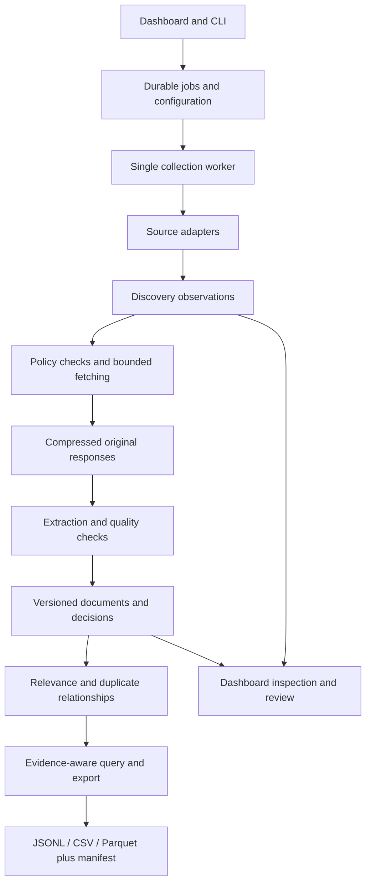

# Financial news collector: architecture proposal

**0.5.0 update, 2026-11-02:** everyday UI is headline-only, with one saved-search/date selection passed to prediction. SQLite, evidence archive and worker boundaries remain. Added bounded public CNBC metadata, TechNode monthly-index and Alibaba Cloud announcement adapters. Publication-date filtering consistently uses New York for instant timestamps; date-only assertions remain explicit. Raw out-of-window observations remain auditable but are excluded from the selected search's results. D56-D60 record this increment; the wider proposal below is not a completed-feature list.

**Release 0.3.0, 2026-10-25:** headline-first account-free source expansion and a five-section local dashboard supersede earlier defaults. Public aggregator, company/publisher feeds, regulatory notices and optional reviewed Bluesky posts are implemented; no account/key dependency or X scraper. See D42-D49, CORPUS_RESEARCH.md and README/VALIDATION for evidence and remaining limits. Earlier proposals below are preserved.

**Version:** original design 0.1, 2026-10-23; implementation status updated below. Read the [claim audit](SOURCE_AUDIT.md) for external evidence and [decision log](DECISIONS.md) for changes from the supplied brief.

**Collector 0.2 follow-up, 2026-10-24:** BABA's NYSE ADSs are the selected pilot. See [CORPUS_RESEARCH.md](CORPUS_RESEARCH.md) and D31-D40 for the implemented issuer archive, per-company SEC forms, source-profile snapshots, optional context scopes, frozen quality audits, balanced body budgets, shared article cohorts and bounded PDF text parsing. PDF-only landing notices are quarantined; the tested official PDF host disallowed requests. Archive replay remains unavailable and the sparse free 2025 pilot is not research-ready. This original proposal is preserved below; current behavior is defined by README/VALIDATION and dated decisions.

**Implementation update, 2026-10-24:** the initial local collector/dashboard has been built. This document preserves the broader design; it is not a feature checklist of completed work. Use [README.md](README.md) and [VALIDATION.md](VALIDATION.md) for the actual supported workflow. In particular, archive replay, Fundus/browser adapters, near-duplicate clustering and full statistical quality evaluation are deferred. See D24-D30 in the decision log for implementation adjustments.

## 1. Product and scope

A local tool for a researcher to collect company-related news, understand its origin and timing, inspect extraction quality, and export reproducible datasets. The professor can reuse it for other companies and studies without installing or selecting an LLM.

Retain the practical targets from the brief: no paid services; Windows laptop with 16 GB RAM; one initial company; configurable entities/sources; live and historical collection; a simple dashboard; documented provenance and failures. The first ticker and its actual IR sources remain unresolved. US regular-session alignment is the initial market profile, not an assumption built into all source adapters.

Do not promise comprehensive free historical news, perfect publisher timestamps, or retroactive reconstruction of a page that was never archived. Make evidence and gaps visible. Preserve raw permitted content without routine expiry; respect source-specific retention restrictions. Disk exhaustion stops acquisition visibly instead of deleting evidence.

Gemma, the cutoff buffer, prediction horizon and price labels belong to a later study profile. The collector's ordinary search/export remains usable outside those dates. A study-specific export can apply explicit cohort/date/input restrictions.

## 2. Recommended structure

Use a **single Python package with modules**, one local worker and a local dashboard. No required cloud services, GPU, message broker, vector database, Docker stack, or LLM extraction in the first version.



**Operational store:** SQLite on a local disk, with WAL, foreign keys, schema migrations, short transactions and a supported SQLite build. A single worker writes ingestion results; dashboard commands/annotations use short transactional repository operations with bounded busy retries. Store no important state exclusively in memory or Streamlit session state.

**Evidence store:** compressed original response bytes addressed by SHA-256, with metadata in SQLite. Archive HTML, JSON/feed responses and permitted filing documents. Preserve fetch headers, status, URL chain, MIME/encoding, timestamps and content hash. Raw bytes precede extraction. Rendered DOM, when needed, is another artifact with its own timestamp and dependency on the fetched response.

**Exchange and export:** immutable JSONL/CSV/Parquet datasets with manifests. DuckDB is optional for analysis of these frozen exports; it is not a second mutable source of truth. This avoids native-file concurrency problems described in the [DuckDB documentation](https://duckdb.org/docs/2.0/connect/concurrency).

**Suggested initial libraries:** HTTPX for HTTP, feedparser for feeds, standard-library SQLite/gzip/hashing, Pydantic for validation, Trafilatura as a baseline extractor, selected Fundus parsers as challengers, exchange_calendars, Typer for CLI and Streamlit for UI. These are provisional implementation choices, not a tested dependency lock. Compare alternatives when the pilot exposes a reason. Add Playwright only for specific permitted sources that need rendering; limit it to one page at a time initially.

## 3. Modules and responsibilities

| Module | Owns | Must not do |
|---|---|---|
| `config` | Validated entity aliases, effective symbol dates, CIK, source URLs, schedule, rate/storage budgets, policies | Store API secrets in committed configuration |
| `sources` | Discovery queries, provider cursor/window state, raw metadata observations, source capabilities | Label forecasts, silently claim a complete history, or fetch through hidden library clients |
| `fetch` | Shared transport, domain/account limits, robots/access checks, redirects, bounded retries and snapshots | Bypass paywalls or let discovered URLs reach local/private endpoints |
| `extract` | Parse stored bytes; document-type/source-specific routing; extraction version and diagnostics | Re-fetch a page silently, invent missing text/times, or overwrite an earlier extraction |
| `entities` / `quality` | Relevance evidence, aliases, extraction quality and document taxonomy | Use price outcomes or an LLM with future knowledge to decide test eligibility |
| `duplicates` | Exact hashes, versioned near-duplicate relationships and eligible representatives | Delete copies or use later stories to rewrite a past export |
| `time` | Timestamp assertions, precision/conflicts, availability evidence and exchange sessions | Replace one clock with another or infer an exact instant from a date-only field |
| `store` / `jobs` | Transactions, artifacts, job leases/checkpoints, attempts, audit decisions | Treat UI reruns as new jobs or hold a write transaction during network waits |
| `query` / `export` | Explicit temporal policy, allowed fields, stable ordering, frozen manifests | Inject provider sentiment, labels, or unverified historical body text into strict exports |
| `ui` / `cli` | The same application services, inspection, jobs and review | Duplicate pipeline logic or render untrusted live HTML with scripts |

This is a module sketch; no directories or package stubs are being created during planning.

## 4. Evidence model: a URL is not an article version

The minimal logical entities are:

| Entity | Key information |
|---|---|
| Entity/source configuration | Stable company ID, time-bounded ticker aliases, CIK, domains, source policy/version and capability checks |
| Run/job/attempt | Config/code hashes, start/end, cursor/window, heartbeat/lease, attempts, status, error, next retry time |
| Discovery observation | Provider item ID, exact returned title/metadata, query and response artifact, provider timestamp assertions, observation time |
| Document | Stable local ID, origin/publisher, requested/final/canonical URLs and accession relationships; never identity solely by mutable title |
| Content version | Raw artifact hash, fetch start/end, archive capture evidence if any, content type, relation to previous version |
| Extraction | Version ID, parser/version/config, text/paragraphs, title, date assertions, diagnostics, creation time; immutable output |
| Timestamp assertion | Value or interval, raw value, precision, timezone, semantic type, source field/evidence, verification/conflict status |
| Assessment | Target company, accepted/rejected, reason code and English explanation, scope, policy version, evidence and recorded time |
| Relationships | Duplicate/syndication/revision/exhibit links, confidence, method/version, evidence and recorded time |
| Annotation | Sampling design, reviewer, answer/uncertainty, timestamp and label version; separated from algorithm decisions |
| Export manifest | Query, cutoff, temporal policy, selected versions/fields, exclusions, configuration, software versions and file hashes |

Keep the brief's three clocks distinct: publisher publication time, provider event time, and our first-seen time. Provider event time additionally needs a semantic type (ingestion, indexing, or provider-reported publication); a provider's copy of `published_utc` is not its receipt time. Record first-seen per source/item and version, with an aggregate earliest observation derived without overwriting history.

Also retain publisher updates, snapshot capture time, our fetch completion, extraction/decision creation time and all timestamp uncertainty. UTC instant columns are nullable. A date-only value remains a date/interval with timezone evidence, never an invented midnight. Maintain contradictory assertions instead of silently choosing whichever permits inclusion.

An IR release and a matching SEC exhibit are separate evidence objects. SEC acceptance may bound availability of the filed exhibit under a documented assumption; it does not reveal when the IR webpage first appeared. An amendment, corrected article, and syndicated copy likewise remain separate versions or documents.

## 5. What `as_of` means

Use explicit evidence policies. The default research-facing API fails closed; browsing historical downloads is a separate operation.

| Policy | Inclusion basis | Claim supported |
|---|---|---|
| `observed` (default) | Required text/metadata version, extraction and eligibility decisions were recorded locally by the cutoff; no conflicting later-publication evidence | What this system had usable by that time, within the captured logs and clock accuracy |
| `archived_replay` (explicit) | Validated archived bytes captured by the cutoff, or a documented source-specific immutable-release policy; later extraction uses a fixed, label-blind method | A retrospective reconstruction from earlier evidence; not a claim that our collector or the historical provider delivered it then |
| Historical browsing | Current downloads grouped by reported publication date, including unverified historical text | Exploration and coverage research only; unavailable through strict prediction export |

For `observed`, evaluate all required content/metadata dependencies, not just an article's first-seen value. For example, a headline first seen at 15:58 does not make a body fetched at 16:10 available at 16:00. The headline may qualify independently; a later title correction may not replace it. At query cutoff A, an included field must have an eligible evidence version at or before A, and the operational decisions used in that replay must also have existed by A.

For `archived_replay`, a capture at 16:05 cannot support a 16:00 query even if the article says 15:00. A capture at 15:50 may support that query after validating URL, response and payload, but only under this archive policy. A current page with an old publication timestamp cannot qualify solely on that timestamp. Current HTML with no update label is not evidence that no edits occurred.

Source release timestamps and EDGAR acceptance are not automatically byte-level proof of historical availability. Validate accession-specific documents, amendments and public dissemination assumptions before allowing an EDGAR reconstruction policy. Until then, retain the material for exploration or use local observation times.

Compute duplicate representatives only from documents eligible at the cutoff, using the pinned policy. Human reviews, new aliases, late discoveries and future clustering must not silently change an earlier export. Save a dataset snapshot/manifest so later corrections create a new result. An archive replay also records its later processing knowledge date and protocol version.

There is no claim that tests prove all publisher metadata true or all future articles impossible. The defensible software claim is that defined inclusion invariants pass their tests and records lacking sufficient evidence are excluded with explanations.

## 6. Collection and state transitions

Each discovered item is persisted immediately, before fetching. Track processing state independently from research eligibility:

```text
discovered -> pending -> fetching -> extracted -> assessed
                         |             |
                         +-> retry_wait+-> extraction_failed
final assessment: accepted or rejected, with reason and policy version
```

Pending/retrying items remain visible; they are not falsely counted as accepted or irrelevant. A settled job reconciles every known discovered item to an accepted/rejected disposition. Exhausted retries and inaccessible content receive operational rejection reasons, not relevance labels. Cancellation/interruption leaves resumable work and an explicit incomplete job. Reprocessing creates a new assessment without erasing the original.

The denominator is **items the source actually returned**. Source outages, quota exhaustion and capped discovery queries are interval-level coverage gaps; they cannot be represented as rejected articles whose existence is unknown. The dashboard must distinguish no returned news, no eligible news, disabled source, unqueried period, query failure and truncated discovery.

Backfill and live collection use the same adapters. Backfill works in persisted date windows with cursors. Live polling has overlap/lookback and periodic reconciliation for delayed records; never advance solely to the largest publication timestamp. Retain first observations on repeat responses. Respect account-level quotas across all tasks, use Retry-After plus bounded exponential backoff, and cache supported conditional responses.

Acquire an exclusive worker lease so CLI and dashboard cannot start competing ingestion loops. UI actions insert idempotent commands; the worker records progress/heartbeats and handles cancellation at safe checkpoints. A closed browser does not stop collection. A sleeping laptop does: report the missed period and perform a labelled catch-up; never claim it was observed live.

Write artifact bytes to a temporary file, hash and atomically publish them, then commit references and processing state in SQLite. Recovery reconciles orphaned artifacts and unfinished jobs. Verify checksums during backup/replay; test restoring the database together with its artifact store. Archive and database timestamps alone are not independent tamper-proof certification.

## 7. Source rollout

1. **Initial pilot: one company, an SEC submissions/8-K path and one permitted IR feed or archive.** Test keyless primary-source behavior and original/exhibit relationships. Both require actual company configuration and source checks.
2. **Aggregator challenger: Massive conditional on research-use clearance and account entitlement; Alpha Vantage remains a candidate.** Compare accessible relevant records, historical bounds, duplicates, timestamp evidence and quota consumption. Decide using observed results. Do not silently replace a rejected primary source with a different content class.
3. **Supplementary discovery: GDELT and SEC-authored releases.** GDELT initially carries unverified historical capability. Add optional publishers/feeds only where incremental coverage justifies maintenance.
4. **Targeted archive recovery: Wayback, then investigate Common Crawl when warranted.** Retrieve captures by cutoff, without executing live scripts or loading present-day assets into the archived evidence. Record archive gaps and source restrictions.

Once the first permitted source path passes its checks, offer live collection early in the implementation. Historical evidence is perishable and cannot be recreated by postponing collection until the dashboard is finished. This plan itself does not schedule or start collection.

## 8. Extraction, relevance and duplication

Fetch once through our controlled transport and compare extractors over those same bytes. Start with Trafilatura and an appropriate Fundus parser where supported. Use a dedicated structural parser for SEC/IR documents when general article extraction loses item/exhibit structure, financial tables or short releases. Compare output against hand-audited fixtures before fixing routing/fallback rules.

Parser success is not sufficient: detect missing headline/body, truncated text, paywall or consent pages, navigation-only output, wrong-language content and metadata conflicts. Reject or queue uncertainty explicitly. A parser fallback cannot silently change the document source or retrieve a later copy. Archive recovery is its own acquisition step with new evidence.

Relevance is a **per-company assessment**, not a destructive filter. Use effective company names, distinctive aliases, unambiguous identifiers, headline/lead/body occurrences and context. The brief's headline/first-paragraph rule is a useful baseline, but will miss later mentions and misclassify common-word tickers. Keep evidence and an uncertain-review queue. Measure false negatives on rejected samples as well as precision on accepted samples.

Use separate taxonomy fields: `document_kind` (filing/release/reporting/opinion/price recap), `origin_role` (issuer/regulator/editorial), `distribution` (original/syndicated), and optional event type. A wire-distributed company release is both primary-origin and syndicated. Unknown stays unknown. Price recaps are flagged, not universally deleted: eligibility depends on the later prediction horizon and protocol.

Begin exact duplicate matching with raw/text hashes and conservative URL normalization. Add near-duplicate similarity only when the pilot shows a need; MinHash is one candidate, not a prerequisite at one-ticker scale. Preserve all copies and differing facts. An export can pick an eligible representative deterministically; it must not let a later-discovered, earlier-dated copy rewrite past inputs.

## 9. Trading sessions and future prediction profiles

Use `America/New_York` for display and an explicit exchange calendar identifier for session logic; UTC for storage. Pin calendar/version and generated schedule. Validate against exchange notices, including exceptional closures as well as recurring holidays.

For a descriptive news-session bucket, choose the first session whose scheduled close is strictly later than the effective availability timestamp. Thus pre-open/intraday news maps to that session; news at/after its actual close maps forward. Define the exact-close convention explicitly. Store separate buckets for reported publication and usable availability where helpful; strict exports use the latter.

This bucket is not the return label. A future study must define observation cutoff, prediction deadline and return start/end. Friday after-close news cannot be used to claim a forecast made before Friday's closing price. Open-to-close and close-to-close targets require different deadlines. Keep label computation outside the collector and do not retrieve prices merely to build the scraper.

## 10. API and export contract

Illustrative interfaces to implement, not currently runnable:

```python
get_news(entity, as_of, *, policy="observed", variant="headline", dataset_snapshot=None)
browse_news(entity, published_from=None, published_to=None)
export_news(query, *, format="jsonl", study_profile=None)
```

`get_news` requires a timezone-aware cutoff and returns records plus eligibility/exclusion and coverage metadata. A missing historical snapshot is distinguishable from no news. No silent downgrade from `observed` to `archived_replay` or historical browsing. A study profile may enforce approved periods and fields; the generic collector does not enforce a particular model's cutoff.

Keep canonical source text immutable. Export headline, headline plus a deterministic number of paragraphs, or full text as separate variants over the same eligible version IDs. Token truncation is optional and requires a named/versioned tokenizer; record original/exported counts, truncation and ordering. Without a tokenizer, offer clearly named character limits rather than pretending characters are tokens. Packet budgets must account for prompt overhead when the future runner exists.

Use an explicit field allowlist for model-facing JSONL. Provider sentiment/reasoning, internal quality labels, human annotations, future prices and rejection metadata are in audit exports only. A historical provider sentiment field is not a valid point-in-time benchmark unless its own availability is established.

Every export includes a companion manifest: schema version, query/window/cutoff, temporal policy, study profile if any, ordered document/version/extraction IDs, hashes, code/config/alias/calendar versions, parser/tokenizer versions, creation time, selected sources, unknowns/exclusions and coverage completeness. Export rights are checked per source; sharing the application does not imply sharing its accumulated articles.

Planned CLI groups: `doctor`, `sources`, `collect`, `backfill`, `inspect`, `reextract`, `export`, `dashboard`. Configuration is TOML with separate secret environment variables. Source/account capability checks produce actionable messages. New tickers require aliases/CIK/source URLs; new website structures may require a new tested adapter.

## 11. Dashboard experience

Use Streamlit initially for a local research tool. Start the dashboard on localhost. The professor's main path is: select company and sources -> choose date range or live collection -> preview expected coverage/limits -> start -> inspect -> export. Plain-language statuses come first; implementation details sit behind an expandable audit view.

| Page | What the user can do | Essential distinction |
|---|---|---|
| Collect | Choose saved company profile, dates/sources, preview and submit job, pause/cancel/resume, see progress | Job state survives UI reruns and browser closure |
| Overview and coverage | See counts, timeline, source distribution, outstanding work and coverage gaps | Captured live vs archived evidence vs unverified historical material; zero news vs failed collection |
| Article inspector | Read extracted text beside escaped raw HTML/source text, versions, timestamp evidence and related copies | Original source vs derivative extraction; per-company relevance vs temporal eligibility |
| Source health | Last success, backlog, quota/rate-limit events, policy/endpoint status, missing windows and disk use | A recently successful request does not establish full historical coverage |
| Review | Blindly label stratified samples as relevant/irrelevant/uncertain and inspect extraction defects | Persist annotations; do not show future returns or algorithm predictions before review |
| Export | Choose evidence policy, text variant and format; preview counts/exclusions and save manifest | Display reconstructed/uncertain evidence explicitly and prevent unverified content entering strict exports |

Raw source HTML is displayed escaped by default. Any later visual preview must be sanitized and isolated from scripts/network access. Dashboard caches are keyed by dataset generation and policy; labels and progress never rely on transient session state. These choices follow [Streamlit's rerun behavior](https://docs.streamlit.io/develop/concepts/architecture/session-state).

## 12. Validation and acceptance gates

**Temporal invariants:** future publication, future capture, later revision, late discovery, early headline/late body, date-only/conflicting timestamps, acceptance vs issuer time, archive redirect to a later capture, and missing evidence. Adding future records must not change an already sealed `observed` export. Test fields, metadata, duplicate choices and assessments, not just article rows.

**Session cases:** pre-open, exact close, after-close, Friday/weekend, holiday, early close, both DST transitions, timezone ambiguity and an exceptional closure. Check library schedules against exchange evidence. Keep market bucket tests separate from future label tests.

**Reliability:** 429/Retry-After, timeouts, malformed JSON/feed/HTML, pagination loops, saturated GDELT windows, missing historical SEC files, delayed provider records, power interruption, worker lease recovery, duplicate job submission, simultaneous dashboard reads/annotations, disk full, checksum mismatch and restore from backup.

**Quality pilot:** propose 60-100 permitted saved documents spanning actual publishers/source types, historical/live cases, short releases, filings/exhibits, duplicates and malformed/blocked responses. Split extractor tuning from held-out checks. Pin bytes, tool versions and scorer. Audit financially meaningful omissions; report failure rates using all attempted documents, not only successful outputs.

**Relevance audit:** approximately 100 annotations is an initial pilot, not a fixed claim of sufficient precision. Sample across source, time, accepted/rejected status and ambiguity. Record sampling probabilities; report appropriate weighted estimates/intervals. Review a shared subset with a second human if feasible. This estimates behavior among discovered items, not recall over all news on the web.

**Performance:** measure wall time, peak process-tree RAM, bytes stored/article and dashboard latency on the user's laptop. Proposed starting budget: two HTTP workers, one extraction worker, one optional browser page, and collection+dashboard below 4 GB peak RAM on the pilot. This is a target to test, not a measured capability. Reduce concurrency before adding infrastructure. Store no whole corpus in an in-memory DataFrame.

**Handover:** clean project-local install, offline fixture demo with shareable data, documented free-key setup where applicable, a bounded permitted live run, source-addition guide, schema/export guide, troubleshooting, backup/restore, and a plain-language professor walkthrough. Test with the dashboard open during collection. Pin a SQLite release containing the [documented WAL fix](https://www.sqlite.org/wal.html).

All implemented invariant tests must pass; unexplained silent drops must be zero in controlled fixtures. Empirical precision, extraction and coverage thresholds are finalized from the pilot before choosing the stack; they must not be invented as achieved results.

## 13. Build sequence and open decisions

1. Select the first company; inspect its actual source access and retention; establish free aggregator eligibility separately. Finalize the small fixture set and timestamp schema.
2. Implement the storage/evidence contract, source-independent fixture replay, temporal query tests and export manifest together. This is the smallest reviewable foundation.
3. Implement one primary-source vertical slice, then a complementary adapter; enable optional live capture once the invariants and recovery pass. Benchmark extractors on stored bytes.
4. Add the minimal collection/inspection dashboard and operational recovery; evaluate it with the user before expanding the UI.
5. Add bounded historical backfill, qualified archive replay and additional discovery sources where the pilot justifies them. Complete relevance/deduplication evaluation.
6. Verify clean setup, exports, coverage reporting and professor handover. Extend toward the prediction runner in a separate task.

**Still open:** initial ticker/company; source/account permissions and actual coverage; archive feasibility for 2024-2025; acceptable storage allocation; exact extractor routes; professor's usability feedback. The future model variant, cutoff assumptions and return definition remain outside this implementation decision.

**Implementation readiness:** the architecture is ready to guide a bounded pilot. It does not justify promising comprehensive free historical coverage or contamination-free LLM evaluation.
